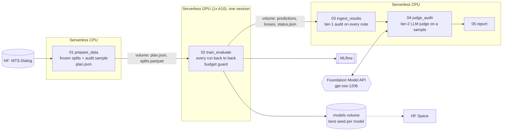

# nlp_med_notes: doctor-patient dialogue → clinical note, on Databricks

Fine-tunes three seq2seq models to turn a doctor-patient conversation from [MTS-Dialog](https://huggingface.co/datasets/har1/MTS_Dialogue-Clinical_Note) into a structured note section (`Symptoms / Diagnosis / History of Patient / Plan of Action`), then audits the notes for hallucinations. It runs as one Databricks job on serverless compute, with a GPU budget guard.

It began as an MSDS 453 class project in Google Colab ([`nlp final project/previous work/`](nlp%20final%20project/previous%20work/)). That work compared ten single-run hyperparameter tweaks by ROUGE. The tweaks moved the metrics less than run-to-run noise, and the real failures (wrong medication placement, symptoms escalated into diagnoses) only appeared in manual review. This version is built around those two lessons: **repeat runs instead of tweaks, and measure faithfulness directly.**

**Roadmap:** ✅ Databricks pipeline → ✅ first full run (3 models × 3 seeds) → ▶️ Hugging Face Space (`space/`) → prod run + publish

## Design



### Experiments: one recipe per model, repeated over seeds

`configs/experiments.yml` holds one entry per model, and its `seeds` list expands it into runs (`biobart_s13`, `biobart_s42`, ...). Each model is reported as mean ± std over its seeds.

| Model | Why it's here | LR |
|---|---|---|
| `GanjinZero/biobart-v2-base` (166M) | Pretrained on biomedical text. Small enough to serve from a CPU-only Space | 5e-5 |
| `facebook/bart-large-cnn` (406M) | General summarizer, the largest model | 3e-5 |
| `google-t5/t5-base` (223M) | A different architecture and pretraining | 3e-4 (T5 needs ~10× BART's LR) |

The recipe is shared across models:
- **Training length:** up to 10 epochs, with early stopping on validation loss (patience 2), keeping the best epoch.
- **Batch and regularization:** effective batch 16, label smoothing 0.1, bf16.
- **Inputs:** the section header goes in with the dialogue, since the section to write is known at inference time.
- **Generation:** defaults are overridden. bart-large-cnn ships `no_repeat_ngram_size=3`, which stops it from writing "N/A." in more than one field.

### Audit: free checks on every note, an LLM judge on a sample

ROUGE and BERTScore are still computed, but they can't tell a fluent hallucination from a faithful note. Faithfulness is audited in two tiers:

| Tier | Runs on | Cost | Checks |
|---|---|---|---|
| 1, `audit.py` | every note | free (CPU) | template compliance; N/A agreement per field; **grounding**: words and numbers in the note that never appear in the dialogue |
| 2, `judge.py` | fixed 40-example test sample, same for every run | pay-per-token | every claim labeled supported / unsupported / contradicted / misplaced, with clinical severity; important omissions |

- **The clinician's reference notes go through both tiers.** That's the ceiling, and it shows how often each check objects to a human-written note. Tier 1 flags 48.6% of references, mostly clinical paraphrase ("I don't smoke" → "nonsmoker"). The flag is a screen to compare between models, not a verdict.
- **The report measures the flag's precision and recall against the judge.** The production idea: a free check screens every note, and a model judge audits a sample to keep the screen honest. A frontier model is never called on every output.
- **The judge is an open-weight model served inside Databricks** (`databricks-gpt-oss-120b`), so audit data stays on the platform. In a test with an invented allergy, it flagged the made-up "sulfa". Any chat endpoint works through the `judge_endpoint` parameter. Claude endpoints are currently disabled on this workspace.

### Cost and efficiency controls

- **One GPU session for all runs,** so startup and package install are paid once. Everything else runs on serverless CPU.
- **Budget guard:** a run is skipped, never started, when `elapsed + estimate > max_train_minutes`. The estimate is the model's `est_minutes` until its first seed finishes, then that run's measured time. The GPU task also has a 3-hour hard timeout and no retries.
- **Failure isolation and incremental status:** one crashed run doesn't end the session, and `status.json` is rewritten after every run, so a timeout keeps finished work.
- **Judge caps:** `judge_sample_size` (examples per run) and `judge_max_calls` (whole task). Token counts are stored per call.
- **Monitoring:** the report shows actual vs estimated minutes per run and an estimated cost. `v_job_run_costs` joins `system.billing.usage` with list prices to show what each job run was actually billed, once billing data lands.

## Tables (`workspace.med_notes_dev` in dev)

| Table | Grain |
|---|---|
| `silver_dialog_notes` | one row per example: text, frozen `split` (train 1038 / val 131 / test 132, stratified by section, repeated dialogues kept on one side) |
| `audit_sample` | the 40 test examples the judge scores for every run |
| `runs` | one row per run per job run: status, minutes, best epoch, val/test metrics, config |
| `predictions` | one row per run per example: note, reference, scores, tier-1 checks |
| `judge_results` | one row per judged note: claim counts by label, severity, score, raw verdict JSON |
| `training_losses`, `reference_checks` | loss curves; tier-1 checks on the references |

Every write is keyed by `job_run_id` and idempotent.

## Run it

```bash
databricks bundle validate
databricks bundle deploy -t dev      # creates the job, starts nothing

# 1. Pilot (the job's default parameters): one BioBART run, 10 judged examples, 30-min GPU cap
databricks bundle run -t dev pipeline

# 2. Full run: 3 models x 3 seeds
databricks bundle run -t dev pipeline --params experiments=group:main,judge_sample_size=40
```

The pilot's `runs.minutes` and the billed cost in `05_report` replace the cost estimates in `experiments.yml` before the full run.

**Interactively:** run `00` and `01` on serverless. Then attach `02_train_evaluate` to **Serverless GPU (A10)** and run it with `job_run_id=manual`.

**Local smoke test** (CPU, a few minutes). It covers config expansion, splits, both audit tiers (with a fake endpoint), and the runner's budget guard, failure isolation and best-seed saving using tiny random models:

```bash
python3 -m venv .venv && source .venv/bin/activate
pip install torch transformers datasets accelerate rouge_score bert_score sentencepiece pyyaml pandas pyarrow databricks-sdk
python tests/smoke_test.py
```

## Hugging Face Space (`space/`)

A Streamlit app with an overview, a note explorer, a "model traps" page and the methods, published as a **static**
Hugging Face Space: [stlite](https://github.com/whitphx/stlite) runs Streamlit in the browser (`space/index.html`),
so the free tier works and there's no server. It reads a snapshot (JSON), not Databricks: the public Space holds no
credentials and keeps working after the workspace is gone.

```bash
# 1. Export a snapshot of chosen job runs (prod for the published version)
databricks bundle run -t dev export_space --params job_run_ids=<run1>,<run2>,export_id=<name>
# 2. Pull the JSON + summary into the Space folder
for f in examples.json notes.json runs.json summary.json; do
  databricks fs cp --overwrite dbfs:/Volumes/workspace/<schema>/pipeline/space_export/<name>/$f space/data/$f; done
# 3. Test headless with regular Streamlit, then check the static build the way HF serves it
cd space && python test_app.py && python -m http.server 8600   # open http://localhost:8600/index.html
```

## Layout

| Path | Contents |
|---|---|
| `databricks.yml` | the `med_notes_pipeline` job, its MLflow experiment, and dev/prod targets |
| `configs/experiments.yml` | models, recipes, seeds, run-time estimates |
| `notebooks/00–05` | thin task notebooks |
| `src/med_notes/` | `data`, `train`, `evaluation`, `audit` (tier 1), `judge` (tier 2), `runner` (GPU session), `ingest` |
| `requirements-train.txt` | installed by the GPU task (a no-op where the AI environment already has them) |

## Known limitations

- **1,301 examples** is small, so the seed spread will be wide. Synthetic data or a larger dataset is a later phase.
- **Tier-1 grounding is lexical.** Synonym-aware matching (scispaCy/UMLS) would cut its false positives.
- **One judge model, no human labels.** Agreement between judges, or a small clinician-labeled set, would validate it.
- Serverless GPU notebook tasks (`compute.hardware_accelerator`) are a Public Preview feature.
