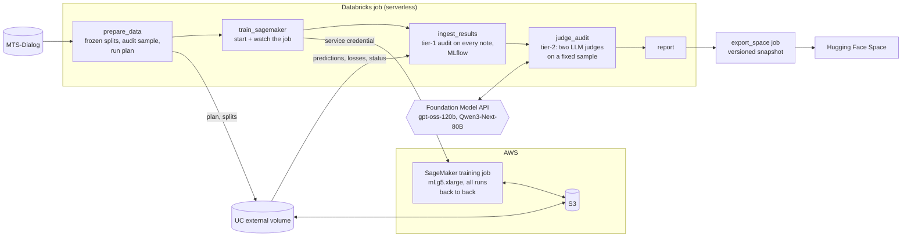

# nlp_med_notes: clinical note generation, audited for faithfulness

Fine-tunes seq2seq models to write one section of a clinical note (`Symptoms / Diagnosis / History of Patient / Plan of Action`) from a doctor-patient conversation, then audits every note for what overlap metrics miss: invented facts, wrong fields, and dropped findings.

**[Live app](https://huggingface.co/spaces/itstheryguy/clinical-note-summarization)** · [Infrastructure repo (SageMaker backend)](https://github.com/itstheryguy/aws-ml-infra) · Data: [MTS-Dialog](https://github.com/abachaa/MTS-Dialog) (CC BY 4.0)

- **Databricks** runs the pipeline as one job: frozen data splits in Delta, a training step, a two-tier audit, MLflow tracking, and a report. Every task runs on serverless compute.
- **AWS SageMaker** does the GPU training (1× A10G, on-demand). Databricks starts and watches the job through a Unity Catalog service credential, and both sides read and write the same files through an S3-backed external volume. No access keys.
- **Two LLM judges** (open-weight models served inside Databricks) audit a fixed sample of notes, and are themselves checked for self-consistency and agreement with each other.
- **Hugging Face** hosts the app: a Streamlit site that runs entirely in the browser (stlite), built from a versioned snapshot of the production run.

> **Status:** complete. Results below are from the production run tagged `results-v1.1`: 4 models × 3 training seeds, 132 test conversations, about $1.80 of GPU time.

## Results

Test split, mean over 3 seeds. "Faithful" means the primary judge found no major error and no major omission in the note. The judge audits the same 40 test conversations for every run.

| | T5-base | BioBART-large | PEGASUS-large | BioBART-base | Clinician notes |
|---|---|---|---|---|---|
| Parameters | 223M | 406M | 568M | 166M | n/a |
| ROUGE-L vs clinician note | 0.642 ± .005 | 0.641 ± .009 | 0.642 ± .005 | 0.631 ± .002 | n/a |
| Follows the 4-field template | 96.7% | 98.0% | 99.7% | 98.0% | 89.4% |
| **Faithful**: judge 1 (gpt-oss-120b) | **23%** | 16% | 16% | 12% | **75%** |
| **Faithful**: judge 2 (Qwen3-Next-80B) | **19%** | 18% | 13% | 11% | 73% |
| Contains a hallucinated claim | 23% | 32% | 25% | 32% | 30% |
| Training time per run (A10G) | 4 min | 5 min | 16 min | 3 min | n/a |

**What it shows:**
- **Fluent isn't faithful.** All four models score the same ROUGE-L (0.631–0.642). Measured by what their notes *claim*, the best is faithful on about a fifth of conversations, against three quarters for clinicians' own notes.
- **Size didn't buy faithfulness.** BioBART-large and PEGASUS-large don't beat T5-base, which is the most faithful model at about 40% of PEGASUS's size and a quarter of its training time.
- **The common failure is omission, not invention.** Models write "N/A" for fields the conversation covers, especially *pertinent negatives* ("no history of diabetes"), which clinicians record and models drop.
- **Seed spread is about the size of the differences.** The original class project compared learning rates one run each; differences of that size are within seed noise here.
- **The rubric matters.** Making the judge's omission rule explicit (prompt v2) roughly halved every faithful rate and reordered the models. Comparisons under one fixed rubric hold up; absolute rates depend on the rubric.

The [app](https://huggingface.co/spaces/itstheryguy/clinical-note-summarization) has every note, the judges' claim-level verdicts, six recurring "traps" with real examples, and the judge-reliability checks.

## How it works



**Training.** One recipe per model, repeated over seeds (`configs/experiments.yml`). Up to 10 epochs with early stopping on validation loss, keeping the best epoch. PEGASUS-large gets a 25-epoch ceiling because at 10 every seed was still improving; it converges around epoch 15. Effective batch 16, label smoothing 0.1, bf16, and the section header as part of the input. All runs share one SageMaker job, so startup is paid once. Each run's results upload as it finishes, and a restarted job skips runs that already succeeded.

**Two-tier audit.** ROUGE and BERTScore are kept, but they can't tell a fluent hallucination from a faithful note.

| Tier | Runs on | Checks |
|---|---|---|
| 1. Deterministic (`audit.py`) | every note, free | 4-field template; N/A agreement per field; **grounding**: words and numbers (including spoken numbers, "nineteen sixty eight" → 1968) that never appear in the dialogue |
| 2. LLM judges (`judge.py`) | fixed 40-conversation sample | every claim labeled supported / unsupported / contradicted / misplaced, with clinical severity; major omissions, including pertinent negatives |

**Making the judge trustworthy.** The judge only *labels*; the 1–5 score and faithful/not are computed from the labels by a fixed rule, so they can't disagree. It runs at temperature 0. Notes are judged in a canonical form and cached by conversation + note + judge + prompt version, so identical notes always get identical verdicts. Two checks measure the judge itself:

| | gpt-oss-120b | Qwen3-Next-80B |
|---|---|---|
| Agrees with itself (faithful/not, 40 deliberate re-judges) | 95% | 90% |
| Agreement between the two judges (480 notes) | 88%, Cohen's κ 0.55 (moderate) | |

The free tier-1 flag catches 39–63% of the judge's hallucinations with 68–88% precision, depending on the model. That makes it a useful screen on every note, but not a replacement for a sampled audit.

## Design decisions

- **Repeat runs, not tweaks.** Each model is trained with 3 seeds and reported as mean ± sd. The class version compared single runs with different learning rates; the seed spread here is as large as those differences.
- **Frozen splits.** Train / val / test (1,038 / 131 / 132) are computed once, stratified by section, with repeated dialogues kept on one side, and stored in Delta, so every run and the app see the same rows.
- **Databricks orchestrates, AWS supplies the GPU.** This workspace can't start Databricks Serverless GPU. Instead of moving the project elsewhere, training is delegated to SageMaker and everything else stays in Databricks. The file contract (`plan.json` in, `predictions` / `losses` / `status.json` out) is the only coupling, so the training backend can be swapped.
- **No self-imposed time limits on training.** The job requests SageMaker's default 24 h maximum. Cost control comes from IAM: the Databricks role can only start allowed instance types.
- **Open-weight judges inside Databricks**, so audit data never leaves the platform, and no frontier model is called on every output.
- **Idempotent writes.** Every table write is keyed by `job_run_id`, so re-running a task never duplicates results.
- **The app reads a snapshot, not Databricks.** The public Space holds no credentials and keeps working after the workspace is gone. Each snapshot records the job run and git tag it came from.

## Run it

Requires a Databricks workspace with Unity Catalog, and the AWS stack from [aws-ml-infra](https://github.com/itstheryguy/aws-ml-infra) (an S3 bucket, a SageMaker role, and two Unity Catalog credentials). Point the bundle at your own resources with variable overrides, so account details stay out of the repo:

```bash
cat > .databricks/bundle/dev/variable-overrides.json <<'EOF'
{"sagemaker_bucket": "<your bucket>", "sagemaker_role_arn": "<your SageMaker execution role ARN>"}
EOF

databricks bundle deploy -t dev
databricks bundle run -t dev pipeline --params experiments=group:pilot           # one run, to check cost and timing
databricks bundle run -t dev pipeline --params experiments=group:main,judge_sample_size=40
```

Results land in the `med_notes_dev` schema (`runs`, `predictions`, `judge_results`, `judge_consistency`), in the MLflow experiment, and in the `report` task's output. `-t prod` writes to `med_notes`.

**Publish the app** from a prod run:

```bash
databricks bundle run -t prod export_space --params job_run_ids=<id>,export_id=<name>,code_version=<git tag>
for f in examples.json notes.json runs.json summary.json; do
  databricks fs cp --overwrite dbfs:/Volumes/workspace/med_notes/pipeline/space_export/<name>/$f space/data/$f; done
python space/test_app.py                       # every page headless + every note card
(cd space && python -m http.server 8600)       # the static build as Hugging Face serves it: localhost:8600/index.html
hf upload itstheryguy/clinical-note-summarization space . --repo-type space \
  --exclude "__pycache__/*" --exclude "*/__pycache__/*" --exclude "test_app.py"
```

**Local tests** (CPU, about 20 s): `python tests/smoke_test.py` covers splits, both audit tiers with a fake endpoint, the judge cache, and the training runner with tiny models. `python space/test_app.py` runs every page of the app headless and renders every note card.

## Layout

| Path | Contents |
|---|---|
| `databricks.yml` | the pipeline and export jobs, MLflow experiment, dev/prod targets |
| `configs/experiments.yml` | models, recipes, seeds; archived recipes kept with notes on why |
| `notebooks/` | thin task notebooks: `00_setup` … `05_report`, `02_train_sagemaker`, `06_export_space_data` |
| `src/med_notes/` | `data`, `train`, `evaluation`, `runner` (training session), `remote` + `sagemaker_job` (SageMaker), `audit` (tier 1), `judge` + `judging` (tier 2), `ingest`, `export` |
| `sagemaker/entry.py` | SageMaker entry point |
| `space/` | the Hugging Face app (Streamlit via stlite) and its data snapshot |
| `tests/smoke_test.py` | local end-to-end checks |

## What didn't work

- **BART-large-CNN** was the original large model. It's tuned to news summarization, and some training seeds collapsed into repeating the start token (`<s><s><s>…`), which decodes to an empty note; 47% of its notes were empty. A minimum decode length didn't fix it. It's archived in `configs/experiments.yml`.
- **Training on serverless CPU** took about 45 s per optimizer step and ran out of memory, which is what led to the SageMaker backend.

## Limitations

- **1,301 conversations** is small; the seed spread is a large share of the differences between models.
- **Tier-1 grounding is lexical.** Clinical paraphrase ("high blood pressure" → "hypertension") is flagged; synonym-aware matching (UMLS) would cut false positives.
- **No clinician-labeled audit.** The two judges agree moderately (κ 0.55); a small human-labeled set would calibrate them.

## Origin

This started as an MSDS 453 class project in Google Colab: three models compared through ten single-run hyperparameter tweaks scored by ROUGE. The tweaks moved the metrics less than run-to-run noise, and the real failures only showed up in manual review. This version is built around those two lessons: **repeat runs instead of tweaks, and measure faithfulness directly.**

## License

Code: [MIT](LICENSE). Data: [MTS-Dialog](https://github.com/abachaa/MTS-Dialog), Ben Abacha et al. (2023), CC BY 4.0.
